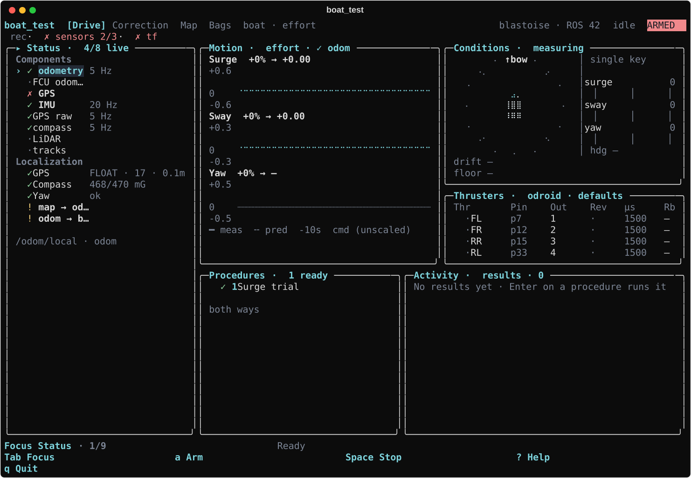
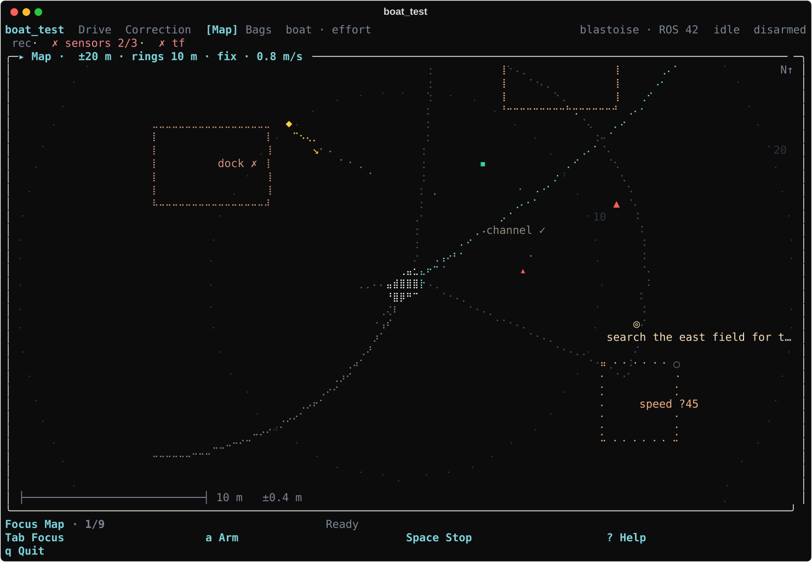
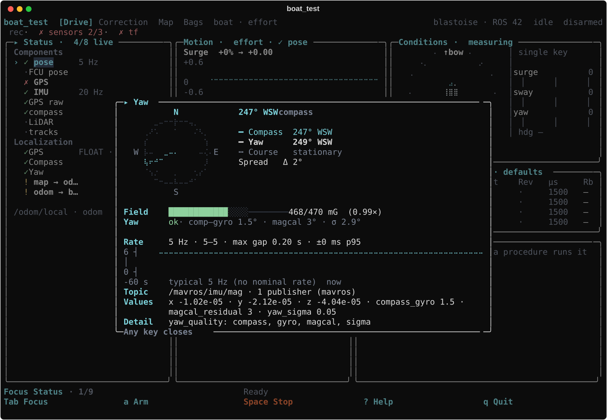
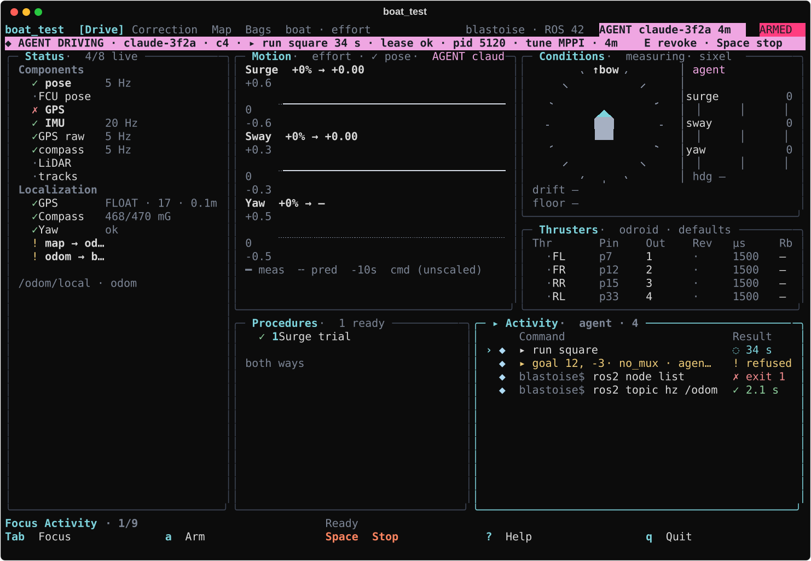

# mhseals_testing

The ASV test suite: sensor and TF checks, thruster trials, characterization, controller, navigation and perception tests, and scored mission rehearsals, on the boat or the [`crane_ml`](https://github.com/1unarzDev/crane_ml) simulator. It drives [`mhseals_hardware`](https://github.com/mhseals/mhseals_hardware) (thruster driver, velocity controller) and [`mhseals_nav`](https://github.com/mhseals/mhseals_nav) (localization, Nav2, task trees) through their public topics and launch files only.

### Screens
<table><tr><td width="50%"><br><sub><b>Drive</b>: status, motion, thrusters, procedures</sub></td><td width="50%"><br><sub><b>Map</b>: track, plan, camera FOV, GPS accuracy, mission goal</sub></td></tr><tr><td><br><sub><b>Inspect</b>: compass popup with field, yaw and rate</sub></td><td><br><sub><b>Agent</b>: banner, revoke keys and the agent log</sub></td></tr></table>

### Usage

```bash
ros2 run mhseals_testing boat_test                                   # start the profile's components marked start
ros2 run mhseals_testing boat_test --profile crane_full_stack        # (or attach when the stack already runs)
```

`boat_test`, `boat_trial` and `rtk_base` install under `lib/mhseals_testing`, not on `PATH`: source `install/setup.bash` and use `ros2 run mhseals_testing <name>`.

`boat_test` starts passive and commands nothing until the outputs are armed. One page, five panels: Status (sensors, TF, health), Motion, Thrusters, Procedures, Activity (results or log). `?` lists every key and is the reference; the ones to know:

- **a** arm panel (typed `ARM` on real pins); **Space** stop (neutral and disarm); **q** quit (neutral, disarm, stop children, write the report, flush the bag).
- **m** manual control: hold W/S, A/D and ←/→ together; +/- speed; x leaves.
- Thrusters: ←→ and 0 test-pulse ±10 µs / neutral; Enter, 1-4, r edit a draft mapping; s/u save or undo; i thruster set; c clear the decoupling.

Held-key chords need the Kitty keyboard protocol (Kitty, Ghostty, foot, WezTerm); other terminals fall back to tap-repeat. Pin, matrix and reversal edits are restart-only; a mapping save applies at the next session. Every state has a glyph (✓ ok, ! warn, × fail, ◌ busy, ○ off), so the page reads without color (`NO_COLOR`); `TERM=dumb` or `MHS_ASCII=1` draws ASCII. Status shows **PWM driver** and **PWM readback** (kernel configuration, not measured voltage or thruster movement), so run on the ODROID for pin readback.

### Procedures

| Key | Procedure | Needs |
| --- | --- | --- |
| f | Characterize (unavailable until the driver supports runtime correction; refuses before arming) | - |
| v | Controller steps: rise, overshoot, settling, error, IAE | armed, sensors, velocity |
| g, e | Compass calibration from a handheld bearing (42006, sent once you type `FCU`); compass interference against thruster effort | -; armed, outputs |
| m, i | Manual control; thruster set | armed |
| n | Nav2 bring-up | - |
| p | Perception rates and costmap | - |
| w, s | Waypoint square; station keeping | armed, sensors, velocity, Nav2 |
| t | Mission rehearsal: run an `mhseals_nav` task, score its events (`config/missions/`) and, in crane_ml, have the referee judge the true track | armed, sensors, velocity, Nav2 |

Procedures that need arming open the arm panel first. Open-loop procedures refuse while another node publishes the command topic; use `--set command_mode=velocity` and Nav2 for navigation procedures. Sizes and timings are settings (`harness/settings.py`; last values persist in `~/.config/mhseals/boat_test.yaml`): `--set amplitude=0.4`, `baseline`, `command`, `settle`, `repeats`, `nav_distance`, `station_hold`, `station_tolerance`, `observe`, `stale_after`.

Only sensors and TF block motion (required sensors live and fresh; `map → odom → base_link` fresh, acyclic, single publisher). Power, clock, links and compute are advisories. `--set bench_override=on` skips the blocking checks; procedures that score motion still refuse.

### Profiles and courses

| Profile | Command | Outputs |
| --- | --- | --- |
| `boat` | `/cmd_vel`, effort | ODROID PWM pins |
| `crane_full_stack` | `/cmd_vel`, effort | `/thrusters/pwm` into the simulator |
| `crane_direct` | `/crane/cmd_vel_stamped`, m/s | none (bypasses navigation) |

`boat_trial profiles` describes each; `--profile <file.yaml>` loads your own. For `crane_full_stack`, start crane_ml with `--crane-disable-sitl --crane-ros-thruster-pwm --crane-roboboat-contract --crane-roboboat-course Tools/RoboBoat/courses/roboboat_2025.json --crane-roboboat-course-truth <bags>/course_truth.json --crane-lidar-returns-only --crane-lidar-water-level 0.02`. For `pair_test` or `circle_test`, edit `config/courses/<task>.yaml` and pass `--crane-roboboat-course "$(ros2 run mhseals_testing boat_trial course circle_test)"`.

### Data

Records go under `$MHSEALS_DATA`, else `$ROS_WS/bags`, else `~/astro_dock/bags`, never the working directory. Each session records one bag (`<root>/<profile>_<time>`, `--output`) of every topic except images, point clouds and costmaps (`config/bags.yaml`), with procedure events on `/mhseals_testing/events`, plus `<session>.report.json`, the driver's `<session>.hardware.yaml` and logs in `<root>/logs/<session>/`. Children stop with the suite, even if it is killed. The layout is described in `mhseals_testing/data.py`.

### Health

Checks are YAML (`config/health/*.yaml`) over facts that probes publish. A `fail` blocks a procedure from starting, a `warn` shows its reason, and nothing interrupts a run. `~/.config/mhseals/health.yaml` can `disable` or `override` checks. Adding a fact, kind or check is described in `mhseals_testing/health/__init__.py`.

Agents drive the boat only through the owner TUI: `boat_trial claim | status | follow | run | goal | stop | mark | note | ask | release` (remotely `ssh blastoise-odroid ~/astro_dock/src/mhseals_testing/tools/boat_agent <verb> --who NAME`) runs each request through the same gates, arm panel and runner as a key and prints JSON (exit 0 ok, 2 refused with a `hint`, 3 revoked or overridden, 4 no TUI, 5 blocked, 6 timeout). No verb releases a hold, and none arms a boat: `run KEY --sim-arm` arms only a stack every check of `harness/sim_arm.py` proves a simulator (sim profile and `/clock`, the crane player, a private domain never 42, localhost discovery, a private-IPC container, no MAVROS or other hardware node, the session's empty hold file, no `<data root>/agent/stop`), re-checks the graph every 5 s and disarms when the run ends or the re-check fails; it is off as shipped (`config/agent.yaml` is the boat's too) and the sim container turns it on with `docker run -e MHSEALS_SIM_ARM=1`. A brand-new sim session clears holds a previous session left in its own hold file (logged), and a `--sim-arm` run's Ready prompts are confirmed by the agent; real-boat and other runs keep the human's. The hook blocks starting the driver or mux by any route and changing the mux's saved holds or the stop file. Space, RC and `E` always win. Leases, allowed procedures and the agent hook are in `config/agent.yaml`. astro_dock's `.agents/hook.py` runs this package's hook, `mhseals_testing/agent_hook.py`, for Claude Code and Codex. It gives the agent this playbook, blocks raw motion and FCU commands with the verb to use instead, and shows the agent's boat commands in the TUI: this machine's TUI, unless `BOAT_AGENT_TARGET=blastoise-odroid` in the agent's environment names a boat session's host (only then does the hook ssh there), so sim and dev work never touches the boat (`blastoise` still works for one release; it means blastoise-odroid). `boat_trial analyze referee <session>`, `index` (`--json`) and `check --require GROUP` re-judge, index and gate finished sessions.

### Development

```bash
python -m pip install pytest rich PyYAML numpy
PYTHONPATH=.:../mhseals_hardware python -m pytest -q test
make -C docs docker-pdf   # docs/math.pdf: the math behind every analysis
```

Everything outside `mhseals_testing/ros/` imports without ROS (enforced by `test/test_import_boundaries.py`). CI runs the tests on Python 3.10, 3.12 and 3.13 and builds `math.pdf`. `make -C docs screens` redraws the images above from synthetic data; a test fails when they are stale. Parameter inventory: `boat_trial config catalog` (`--json -`) or TUI **Config → Catalog**.
