# mhseals_testing

The ASV test console and suite: sensor and TF checks, thruster trials, characterization, controller, navigation and
perception tests, and scored mission rehearsals, on the boat or the [`crane_ml`](https://github.com/1unarzDev/crane_ml)
simulator. It drives [`mhseals_hardware`](https://github.com/mhseals/mhseals_hardware) and
[`mhseals_nav`](https://github.com/mhseals/mhseals_nav) only through their public topics and launch files.

| Command | Purpose |
| --- | --- |
| `tools/boat_tui up` / `view` / `restart` / `status` | The boat's TUI in `tmux -L boat`: start it, watch it, swap in new TUI code (the stack keeps running), who controls |
| `tools/boat_tui sim [--seed N]` / `sim down` | Headless Unity sim and the TUI on it, for agents and quick checks |
| `tools/boat_tui preview [REF] [--headless]` / `preview down` | The owner's preview of REF before a boat test: its own build, container and checklist |
| `ros2 run mhseals_testing boat_test [--profile P]` | The TUI itself (`boat`, `crane_full_stack`, `crane_direct`) |
| `ros2 run mhseals_testing boat_trial ...` | Headless: `check`, `profiles`, `analyze`, `index`, `config`, and the agent verbs |
| `tools/boat_agent <verb> --who ID` | Agents act on the boat or sim only through this ([Agents](#agents)) |
| `tools/smoke` | The landing gate, under a minute |

## Where to run it

- **Tomorrow (11-02):** the TUI runs on the odroid in `tmux -L boat`; the station attaches over ssh:
  `ssh -t blastoise-odroid tmux -L boat attach -t boat` (`boat_tui up` prints this line).
- The operator heartbeat is a station service: `./hw.sh station take` installs and starts it, wherever the TUI runs.
- **Target design:** a lean boat backend (ROS, recorder, stack, agent desk; survives link loss) and a station client
  that renders and reads keys locally; the link carries summarized state and throttled frames. Raw `/points` stays for rviz.

## Quick start

```bash
tools/boat_tui sim [--seed N] [--build]   # agents' sim: one heavy unity job, headless; attach: tmux -L boat attach -t sim
tools/boat_tui preview                    # the owner: origin/main windowed, TUI attached; preview attach | restart | down
tools/boat_tui preview field/x --headless # any branch, field branch or hypothesis ref; xvfb instead of a window
```

- **sim:** a private-IPC container, a free `ROS_DOMAIN_ID` (101-199, localhost), `crane_full_stack`, the 2026 course of
  the seed. Settings: `config/sim/stack.yaml` (`BOAT_SIM_<KEY>`); `--dry-run` prints the plan.
- **preview:** REF of the three packages as worktrees in `~/.cache/boat-preview/<ref>`, rebuilt only when a sha changes,
  in `roboboat_preview` (domain 100, port 6768, `tmux -L preview`). It holds the reserved heavy `preview` slot, which
  agent Unity jobs queue behind. Settings: `config/preview.yaml`. Agents never start or stop it (the hook denies it).
- **Checklist:** the preview's side panel lists the checks, the field runbook's "before a test" items and the commits
  since 2026-11-01 by feature. `W` checks, `p` pass, `f` fail, `n` note; results append to `mhseals_agents/state/preview-<date>.md`.

## Screens

<!-- screens: docs/screens/screens.yaml --><table><tr><td width="50%">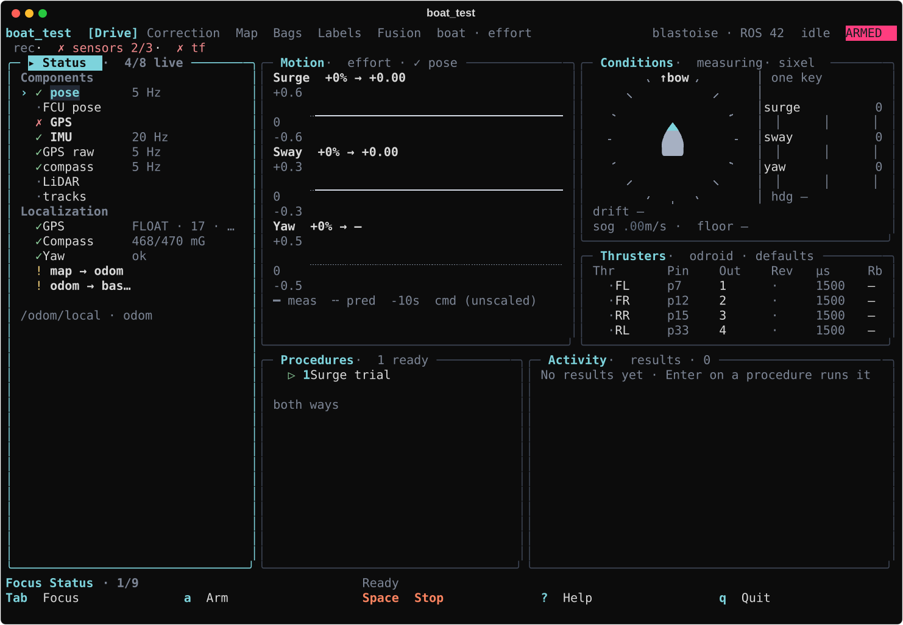<br><sub><b>Drive</b>: status, motion, thrusters, procedures</sub></td><td width="50%">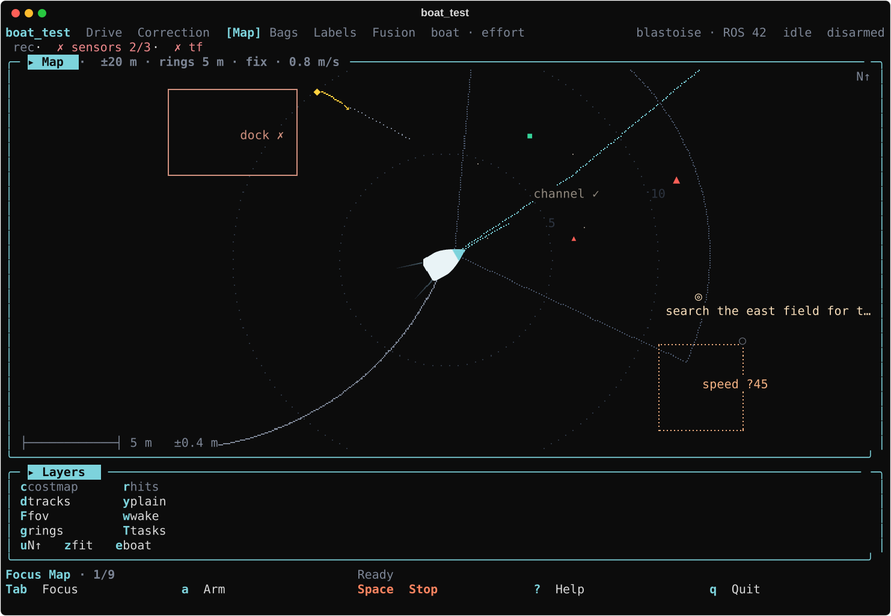<br><sub><b>Map</b>: track, plan, camera FOV, GPS accuracy, mission goal</sub></td></tr><tr><td width="50%">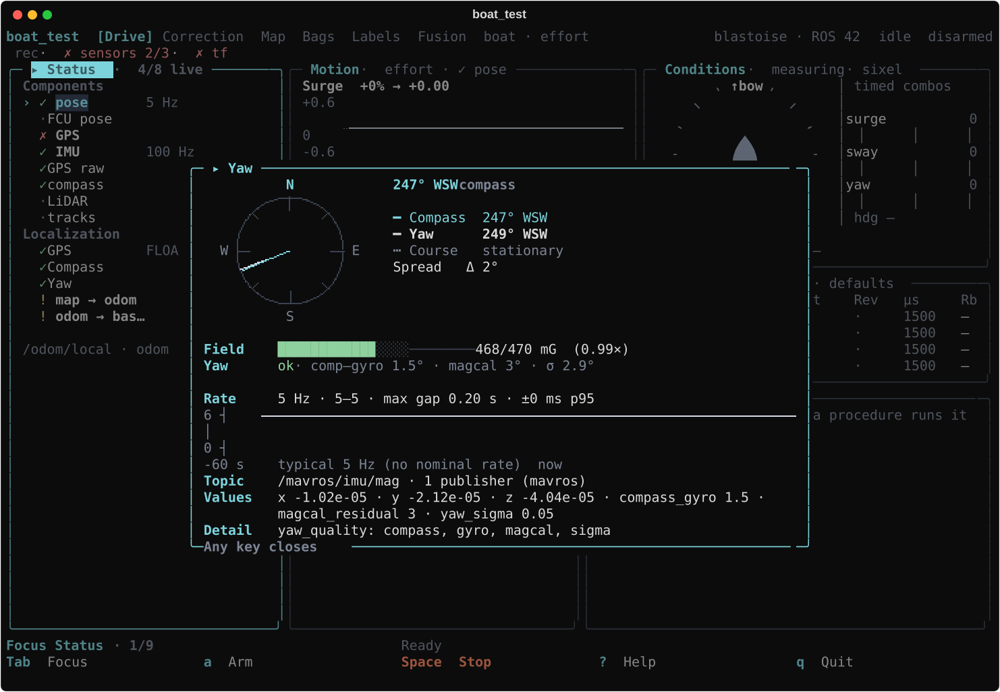<br><sub><b>Inspect</b>: compass popup with field, yaw and rate</sub></td><td width="50%">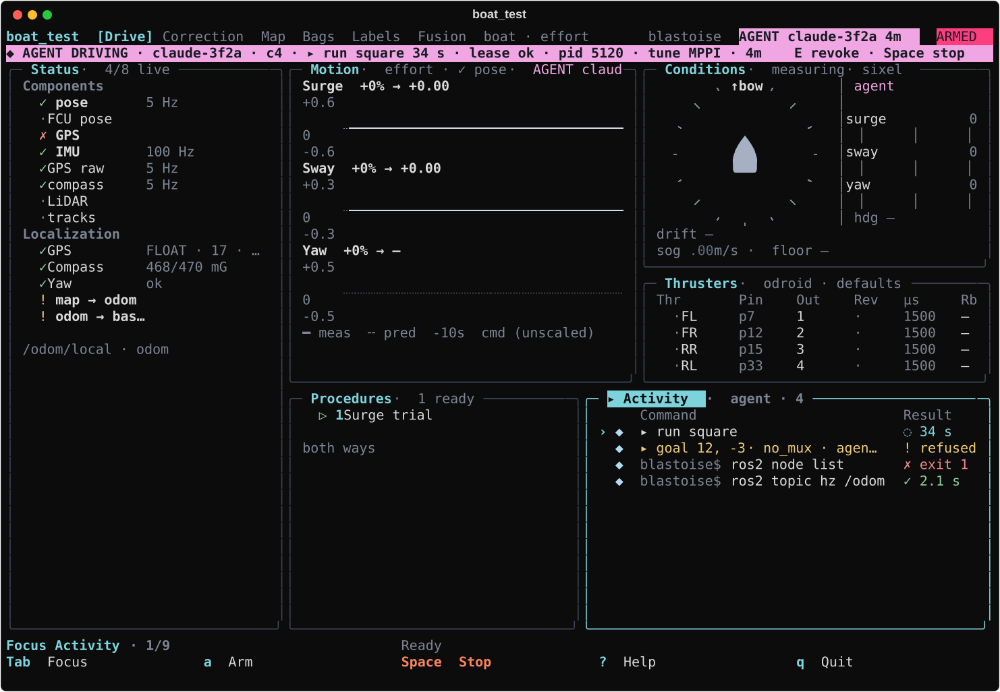<br><sub><b>Agent</b>: banner, revoke keys and the agent log</sub></td></tr><tr><td width="50%">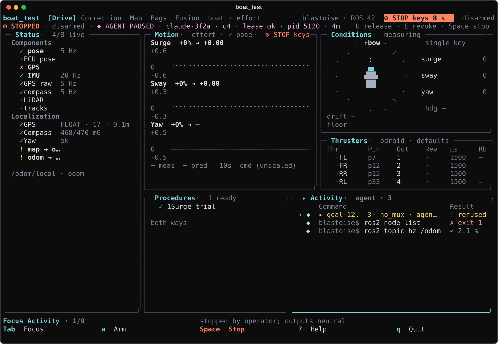<br><sub><b>Stopped</b>: Space under an agent claim keeps STOPPED first and names the paused claim</sub></td><td width="50%">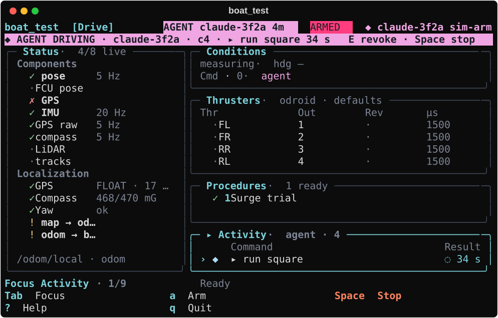<br><sub><b>Sim-arm</b>: at 80 columns an agent's arm keeps the ARMED chip and banner in view</sub></td></tr><tr><td width="50%">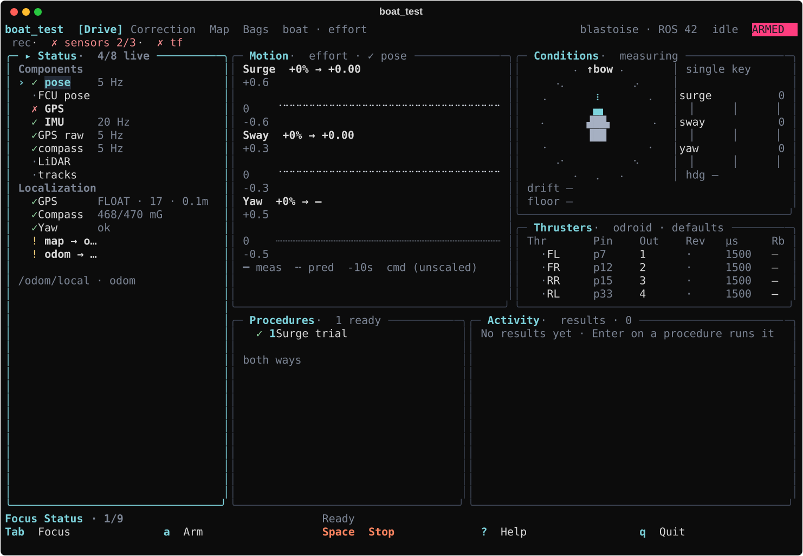<br><sub><b>Text</b>: the Drive tab in braille (graphics off, tmux, SSH without images)</sub></td><td width="50%">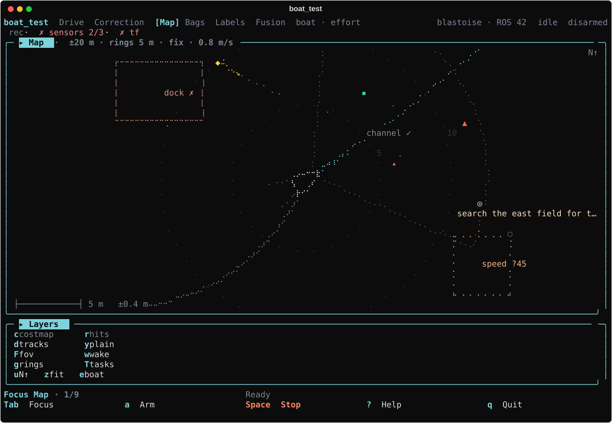<br><sub><b>Text</b>: the Map tab in braille</sub></td></tr><tr><td width="50%">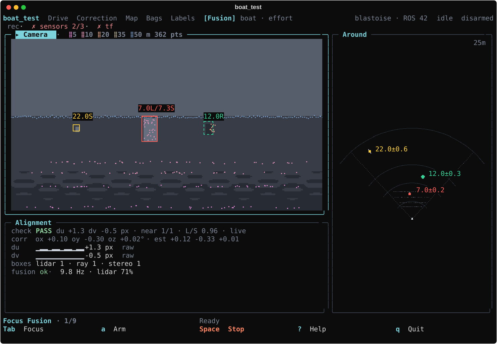<br><sub><b>Fusion</b>: lidar points over the camera, boxes with fused ranges, top-down and the alignment check</sub></td><td width="50%">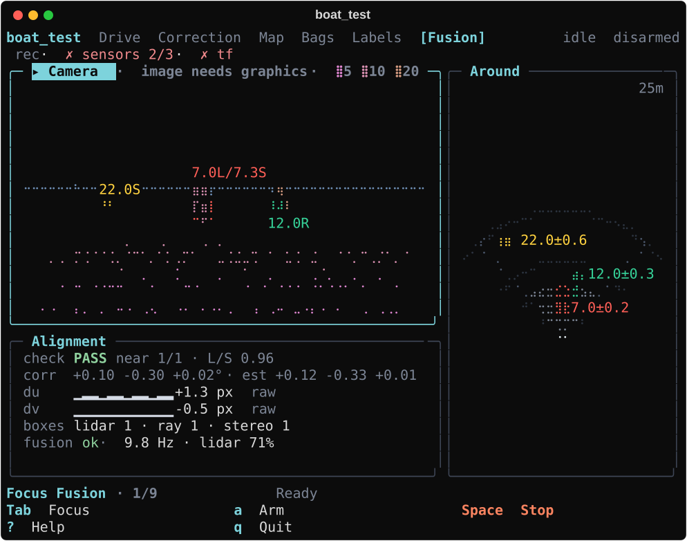<br><sub><b>Text</b>: the Fusion tab in braille at 80 columns</sub></td></tr><tr><td width="50%">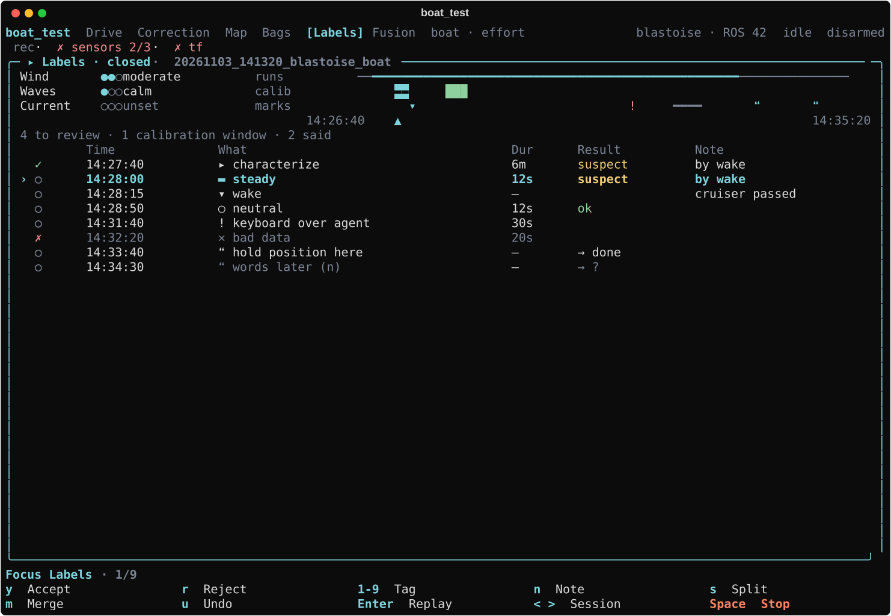<br><sub><b>Labels</b>: water conditions, the session timeline and the review list (L)</sub></td><td width="50%">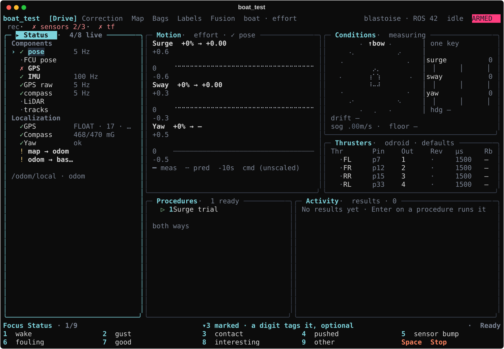<br><sub><b>Mark</b>: b marks at once; the footer offers the digit tags for 3 s, nothing pops up</sub></td></tr></table><!-- /screens -->

## TUI

Tabs (`[` `]`): **Drive** (Status, Motion, Conditions, Thrusters, Procedures, Activity), **Correction**, **Map**, **Bags**,
**Fusion**. `?` lists every key and is the reference. The ones to know:

<!-- keys: config/keymap.yaml -->
| Key | Does |
| --- | --- |
| `Ctrl h j k l / arrows` | Move focus; Enter runs or opens the row |
| `Space` | Stop: hold, neutral, disarm; aborts a run |
| `a` | Arm panel (typed ARM on real pins) |
| `E` | Revoke the agent (stops first, no confirm) |
| `O` | Take control (a viewer; the owner stops at neutral) |
| `b / B` | Mark now; 1-9 within 3 s tags it (wake, gust, contact ...) |
| `N` | Bad data on / off |
| `"` | Log a spoken instruction (1-8 picks the words) |
| `q` | Quit: neutral, disarm, report, bag flush (never kill the tmux session) |
| `w s ↑↓` | Manual (m): hold w/s, a/d, ←/→ together; +/- speed; x leaves |
<!-- /keys -->

Held-key chords need the Kitty keyboard protocol (Kitty, Ghostty, foot, WezTerm). Glyphs carry every state
(✓ ok, ! warn, × fail, ◌ busy, ○ off), so `NO_COLOR` reads; `TERM=dumb` or `MHS_ASCII=1` draws ASCII.

## Procedures

| Key | Procedure | Needs |
| --- | --- | --- |
| f | Characterize: C staged live, read back, progress bar | armed |
| v | Controller steps: rise, overshoot, settling, IAE | armed, sensors, velocity |
| g, e | Compass calibration; compass interference | -; armed |
| m, i | Manual; thruster set | armed |
| n, p | Nav2 bring-up; perception rates and costmap | - |
| w, s | Waypoint square; station keeping | armed, sensors, velocity, Nav2 |
| t | Mission rehearsal, scored (`config/missions/`), judged by the referee in crane_ml | armed, sensors, velocity, Nav2 |

Only sensors and TF block motion; power, clock, links and compute advise. Settings: `--set K=V` (`harness/settings.py`,
saved in `~/.config/mhseals/boat_test.yaml`). Profiles: `boat` (ODROID pins), `crane_full_stack` (`/thrusters/pwm` into
the sim), `crane_direct` (no navigation); `boat_trial profiles` explains each.

## Agents

Agents act only through the TUI: `tools/boat_agent <verb> --who ID` (JSON out); `python3 .agents/hook.py --playbook` is the guide.

- **Verbs:** `status`, `claim`, `run KEY`, `goal X Y`, `arm` (a countdown the operator cancels), `start`/`stop`/`reload`
  COMPONENT, `set K=V`, `fcu get|set|rates|revert|restart`, `follow`, `mark`, `note`, `ask`, `stop`. Every acting verb takes `--why`.
- **Release and grants:** `release HOLD --why` frees a lease or watchdog hold once its fault cleared; an operator hold only
  with a grant in `~/.config/mhseals/agent_grants.yaml`; the e-stop never.
- **Fence:** `fence corners LAT,LON ... | on_exit alert|return | anchor --why`, any time, no claim: validated, read back,
  kept in `~/.config/mhseals/fence.yaml` and named in the agent panel.
- **Exit codes:** 0 ok, 2 refused (read `hint`), 3 revoked, 4 no TUI, 5 blocked, 6 timeout, 7 paused by the operator.
- **Hook:** `mhseals_testing/agent_hook.py` blocks raw motion, FCU and hold changes and names the verb instead. Details: [docs/agents.md](docs/agents.md).

## Data

Sessions record under `$MHSEALS_DATA`, else `$ROS_WS/bags`, else `~/astro_dock/bags`: one bag per session (all topics
but images, clouds and costmaps, `config/bags.yaml`), `<session>.report.json`, the driver's hardware YAML and logs.
Health checks are YAML (`config/health/`); `~/.config/mhseals/health.yaml` disables or overrides them.

Labels: `b` marks (a digit tags it), `N` brackets bad data, `"` logs an operator instruction with the pose, and the
TUI journals procedures, steps, arming, takeovers, link holds, fence exits, fix changes and steady command windows
by itself. The Labels tab (`L`) sets the water conditions and reviews a session; `manifest.json`
(`mhseals.session_manifest/1`, `annotate/manifest.py`) beside the bag is what the judge, the plant card and the NLC
study read. Operator cheat sheet: [docs/labels.md](docs/labels.md); tags and phrases: `config/annotate.yaml`.

## Development

```bash
tools/smoke                 # the landing gate (< 60 s); the full suite (pytest -q test) runs in CI and never blocks
tools/smoke --impact        # only the tests timpact selects against origin/main (ALL: the full smoke)
make -C docs pdf screens    # docs/math.pdf, docs/tuning.pdf, and the images above
```

Everything outside `mhseals_testing/ros/` imports without ROS. Sims and full suites go through `.handoff/tools/heavy`.
